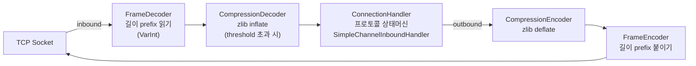
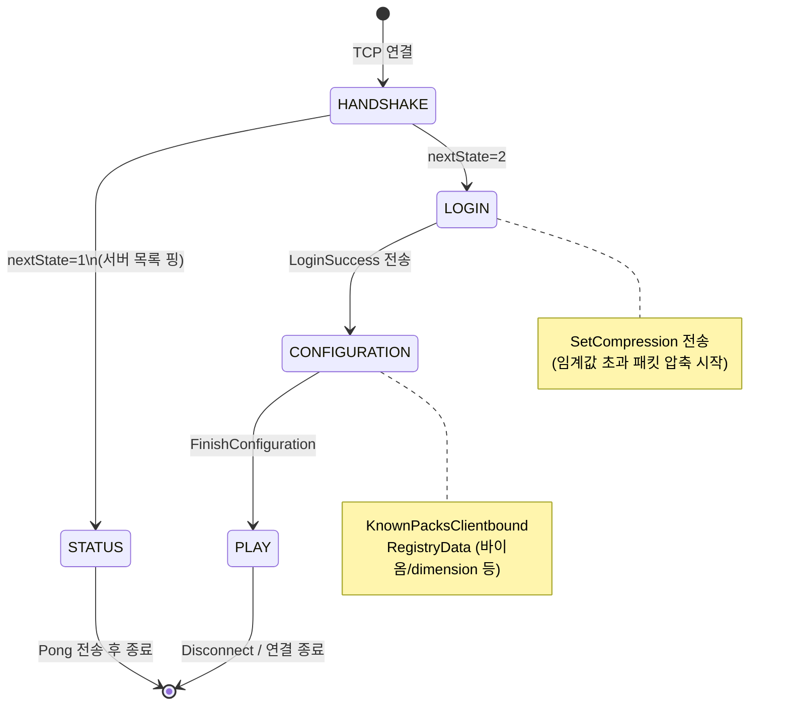
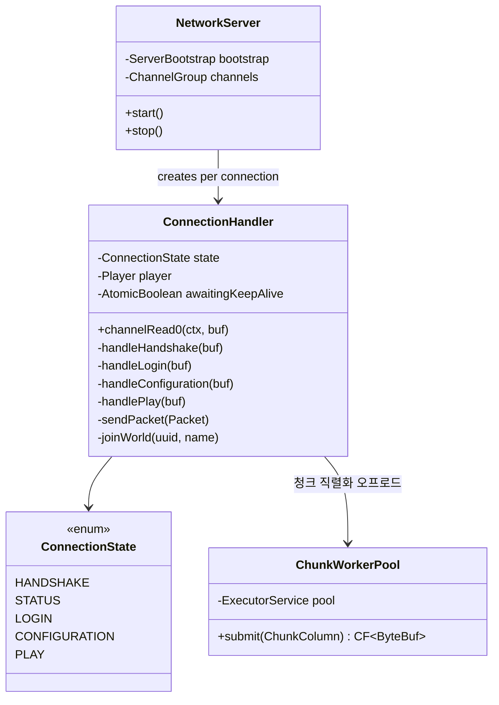
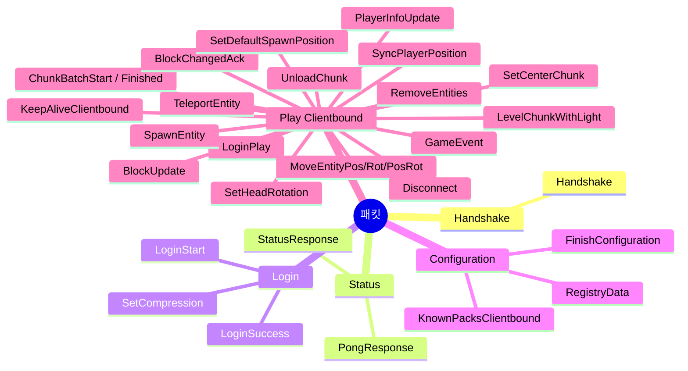
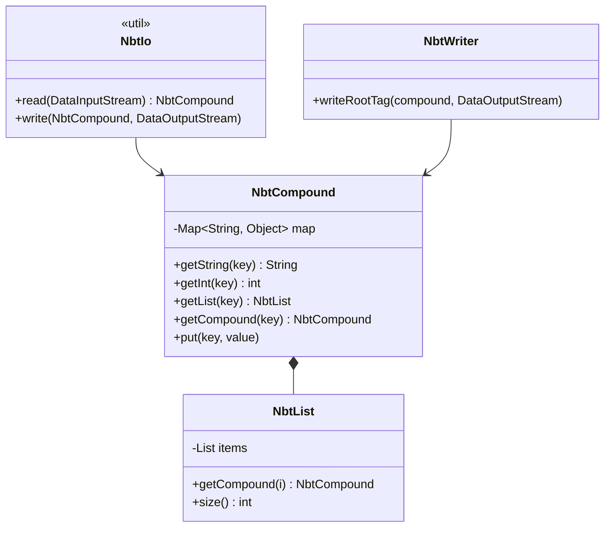
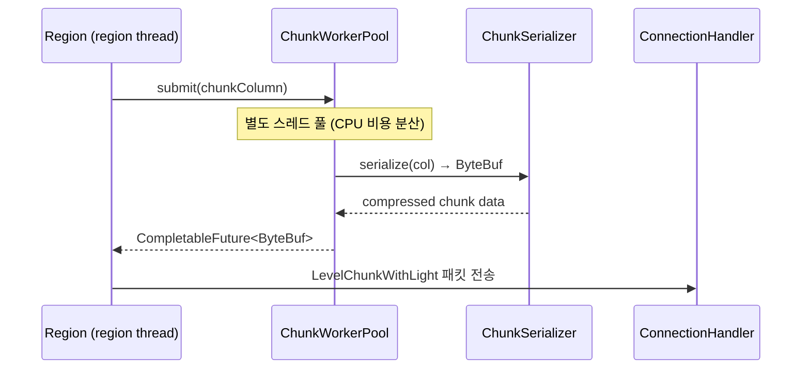

---
tags:
  - Furnace
  - Network
  - Netty
  - Protocol
aliases:
  - Furnace Network
---

# 네트워크 레이어

[[아키텍처-개요]] > 네트워크

## Netty 파이프라인

## 프로토콜 상태머신

## 클래스 구조

## 패킷 클래스 목록

## IO 유틸리티

| 클래스 | 역할 |
|---|---|
| `Types` | VarInt/VarLong/String/UUID/BlockPos read·write |
| `FrameDecoder` | TCP 스트림 → 길이 확정 ByteBuf |
| `FrameEncoder` | ByteBuf → VarInt 길이 prefix 추가 |
| `CompressionDecoder` | zlib inflate (threshold 이상 패킷) |
| `CompressionEncoder` | zlib deflate (threshold 이상 패킷) |

## NBT

## 청크 직렬화 흐름

> [!warning] block_changed_ack (0x05)
> Creative 모드 블록 설치/파괴 후 반드시 전송해야 한다.
> 누락 시 클라이언트 화면에서 ghostblock 고착.

## 관련 파일

- `net/NetworkServer.java`
- `net/ConnectionHandler.java`
- `net/ChunkWorkerPool.java`
- `net/io/Types.java`, `FrameDecoder.java`, `CompressionDecoder.java`
- `net/io/nbt/NbtCompound.java`, `NbtIo.java`
- `net/protocol/play/ChunkSerializer.java`
- `net/registry/RegistrySet.java`
