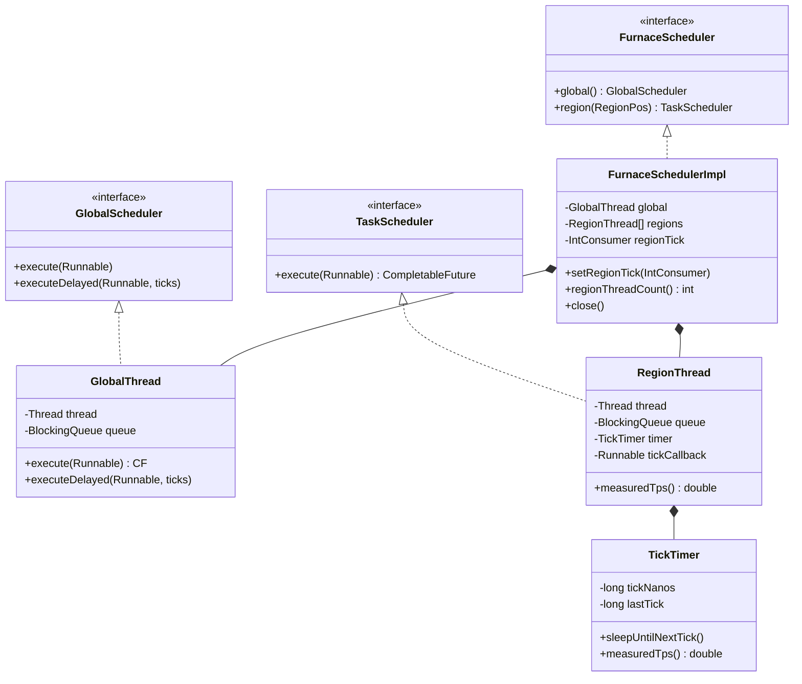
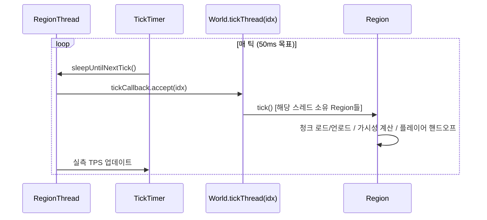
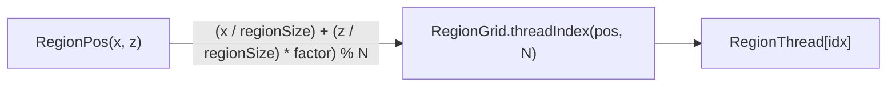
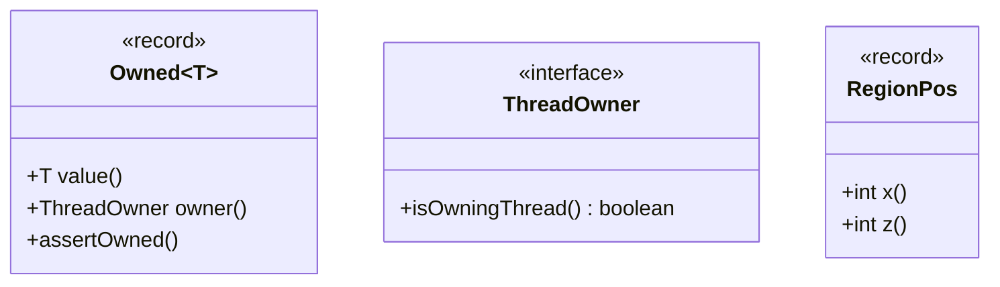

---
tags:
  - Furnace
  - Scheduler
  - Threading
aliases:
  - Furnace Scheduler
---

# 스케줄러 레이어

[[아키텍처-개요]] > 스케줄러

## 클래스 다이어그램

## 틱 루프 흐름

## 스레드 라우팅

> [!note] RegionGrid 해시 방식
> `threadIndex(pos, N)` = `(Math.abs(pos.x() * 31 + pos.z()) % N)`
> 인접 region이 같은 스레드에 몰리지 않도록 소수 곱셈 분산.

## API 패키지 (`furnace-api`)

> [!tip] Owned\<T\> 사용 패턴
> `Owned<ChunkColumn>` 등 소유권을 타입 수준에서 명시.
> `assertOwned()` → 소유 스레드 아니면 즉시 예외. 버그 조기 발견용.

## 관련 파일

- `furnace-api/src/main/java/.../sched/FurnaceScheduler.java`
- `furnace-api/src/main/java/.../sched/TaskScheduler.java`
- `furnace-api/src/main/java/.../concurrent/Owned.java`
- `furnace-server/src/main/java/.../sched/FurnaceSchedulerImpl.java`
- `furnace-server/src/main/java/.../sched/RegionThread.java`
- `furnace-server/src/main/java/.../sched/GlobalThread.java`
- `furnace-server/src/main/java/.../sched/TickTimer.java`
