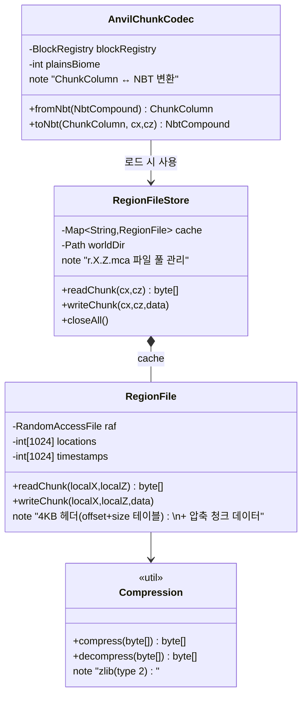
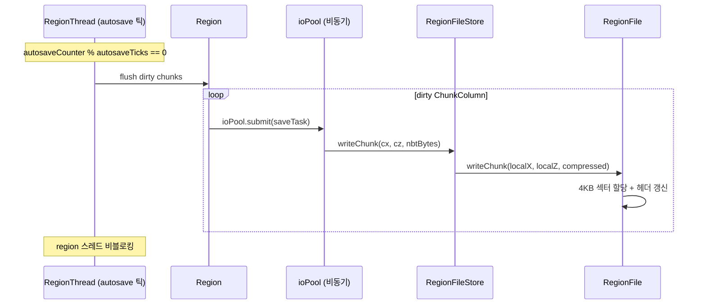
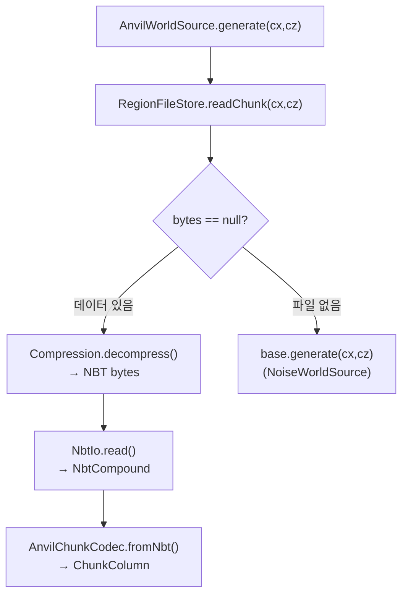

---
tags:
  - Furnace
  - Persistence
  - Anvil
  - IO
aliases:
  - Furnace Persistence
---

# 영속성 레이어

[[아키텍처-개요]] > 영속성

## 클래스 구조



## .mca 파일 구조

```
r.X.Z.mca
├── Header (8192 bytes)
│   ├── Locations [0..1023] — 각 4바이트: (offset<<8)|sectorCount
│   └── Timestamps [1024..2047] — 각 4바이트: unix timestamp
└── Chunk Data (가변 길이)
    ├── length (4 bytes, big-endian)
    ├── compression_type (1 byte: 2=zlib)
    └── compressed NBT data
```

> [!info] 좌표 → 파일 매핑
> - region 파일: `r.(chunkX>>5).(chunkZ>>5).mca`
> - 파일 내 인덱스: `(chunkX & 31) + (chunkZ & 31) * 32`

## 청크 저장 흐름



## 청크 로드 흐름



## AnvilChunkCodec NBT 구조

```
Level (root)
├── xPos, zPos
├── sections[]
│   ├── Y (section index 0..23)
│   ├── block_states
│   │   ├── palette [{Name, Properties}]
│   │   └── data (long[] packed bits)
│   └── biomes
│       ├── palette [biome id strings]
│       └── data (long[] packed bits, 4×4×4)
└── Heightmaps
    └── MOTION_BLOCKING (long[37])
```

> [!warning] autosave 주의
> `furnace.properties`: `autosave-ticks=200`
> IntelliJ "Stop" 버튼 = JVM kill → **shutdown hook 스킵** → 마지막 청크 유실 가능.
> 반드시 Ctrl+C 또는 stop 명령으로 종료할 것.

## PlayerData 저장

```mermaid
flowchart LR
    PD["PlayerData\n(위치·인벤토리)"]
    NBT["NbtCompound"]
    FILE["playerdata/{UUID}.dat"]

    PD -->|toNbt()| NBT -->|NbtIo.write()| FILE
    FILE -->|NbtIo.read()| NBT -->|fromNbt()| PD
```

저장 경로: `{worldDir}/playerdata/{uuid}.dat`

## 관련 파일

- `world/anvil/RegionFileStore.java`
- `world/anvil/RegionFile.java`
- `world/anvil/AnvilChunkCodec.java`
- `world/anvil/Compression.java`
- `world/gen/AnvilWorldSource.java`
- `entity/PlayerData.java`
- `net/io/nbt/NbtIo.java`, `NbtCompound.java`, `NbtWriter.java`
