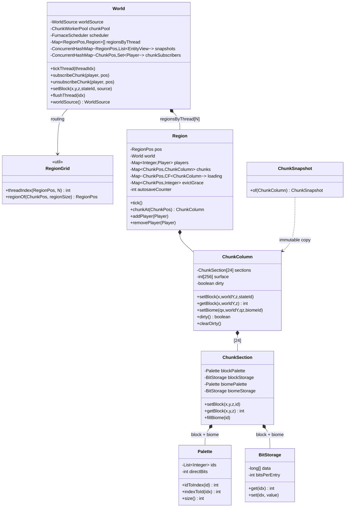
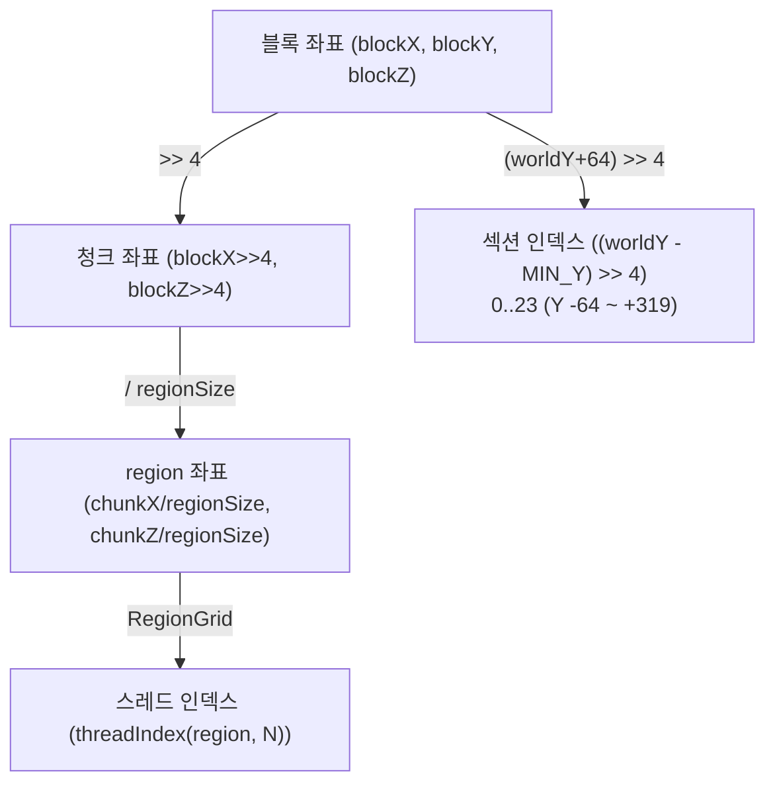
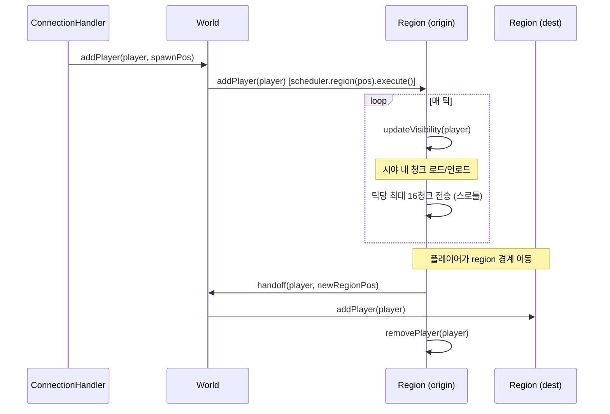
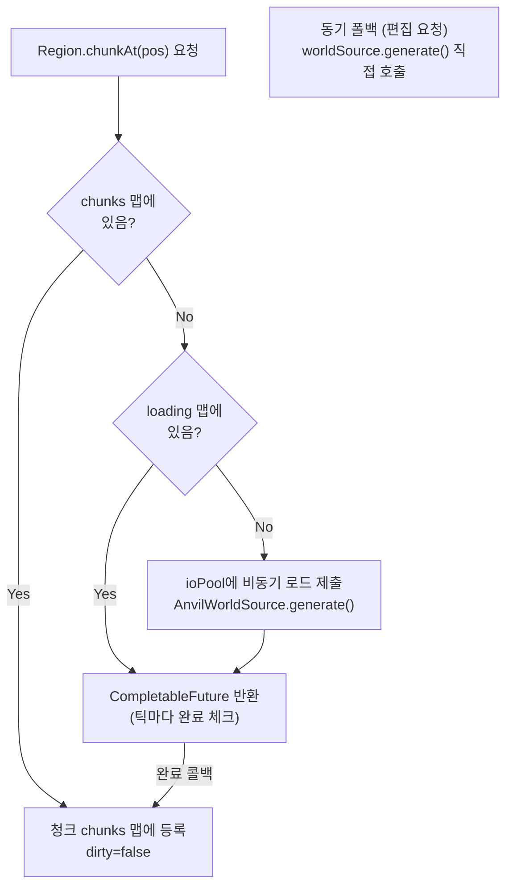
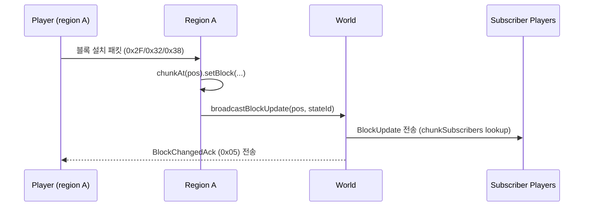

---
tags:
  - Furnace
  - World
  - Chunk
  - Region
  - Threading
aliases:
  - Furnace World Layer
---

# 월드 레이어

[[아키텍처-개요]] > 월드

## 계층 구조

## 청크 좌표계

## 플레이어 생애주기

## 청크 로드 흐름

## 블록 변경 브로드캐스트

> [!warning] 구독-전송 레이스 (미해결)
> `subscribeChunk` 직후 실제 전송 전 갭에서 block_update가 날아갈 수 있음.
> 클라이언트가 청크 수신 전 블록 업데이트를 받으면 무시.
> **M4d/M5에서 수정 예정.**

## 스폰 로직 핵심

> [!tip] 낙하 방지 5단계
> 1. `GameEvent(13)` 전송 (GE13 = start waiting for level chunks)
> 2. 스폰 청크 **동기** 전송 (`snapshotChunk().get(2s)` timeout)
> 3. `SyncPlayerPosition` 게이팅 (청크 전송 완료 후)
> 4. Y + 0.05 오프셋 (블록 표면 위 확실히 배치)
> 5. 틱당 ≤ 16 청크, nearest-first 우선순위

## ChunkPos / ChunkSnapshot

| 클래스 | 역할 |
|---|---|
| `ChunkPos` | record(x, z) — 청크 좌표 값 타입 |
| `ChunkSnapshot` | ChunkColumn 불변 스냅샷 — 청크 직렬화 스레드로 넘길 때 사용 |

## 관련 파일

- `world/World.java`
- `world/Region.java`
- `world/RegionGrid.java`
- `world/ChunkColumn.java`
- `world/ChunkSection.java`
- `world/ChunkPos.java`
- `world/ChunkSnapshot.java`
- `world/Palette.java`
- `world/BitStorage.java`
- `world/BlockRegistry.java`, `ItemRegistry.java`
- `entity/Player.java`
- `entity/EntityView.java`
- `entity/EntityIdAllocator.java`
- `entity/PlayerData.java`
