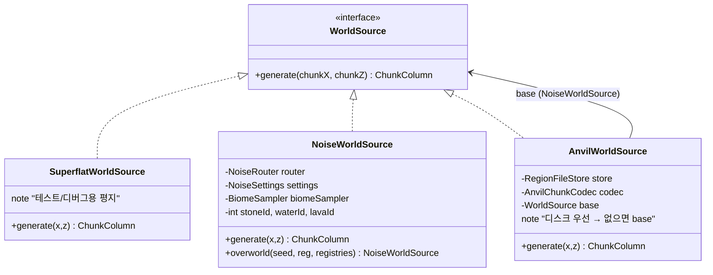
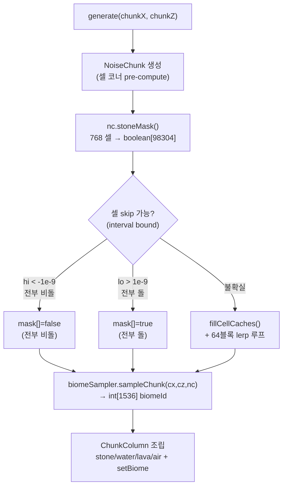
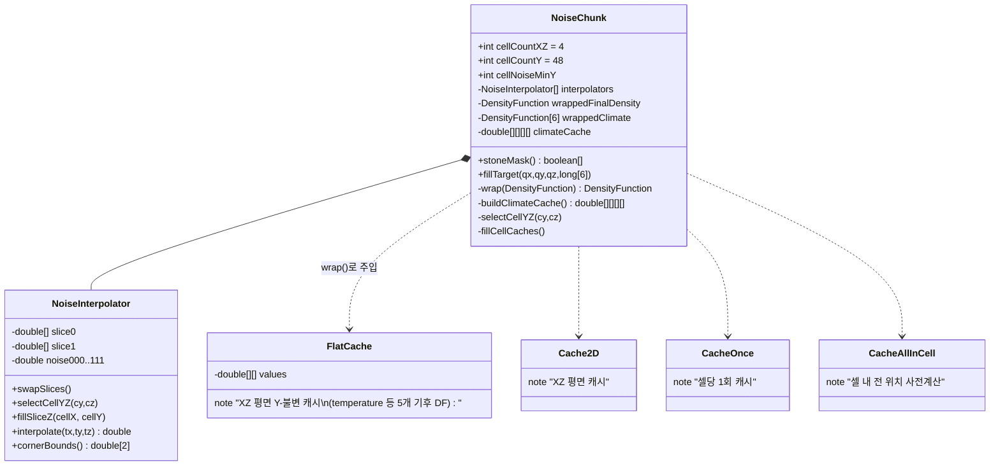
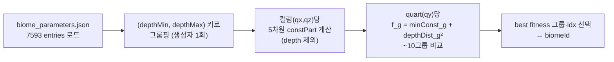
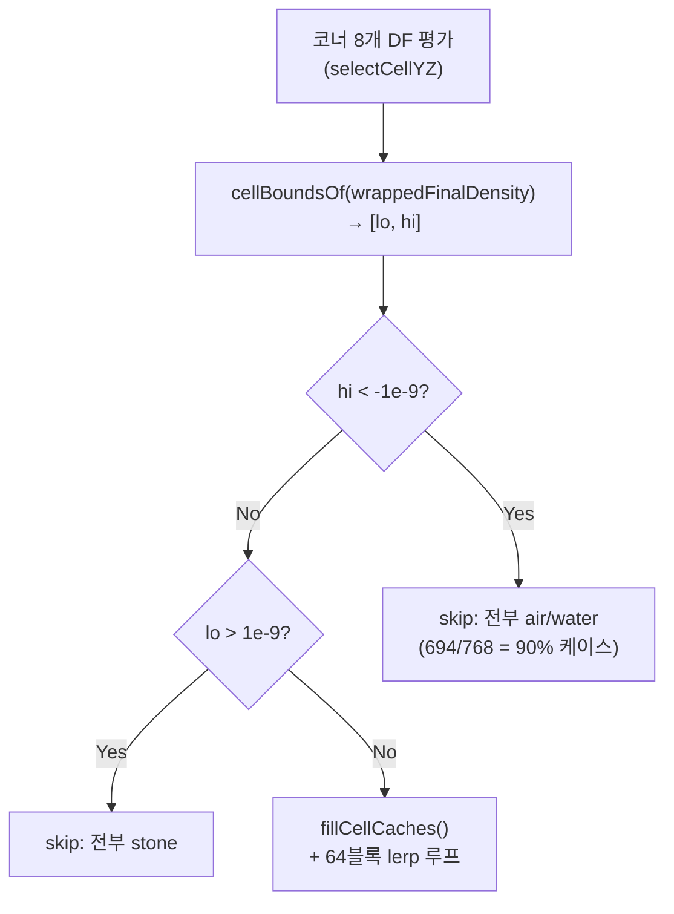
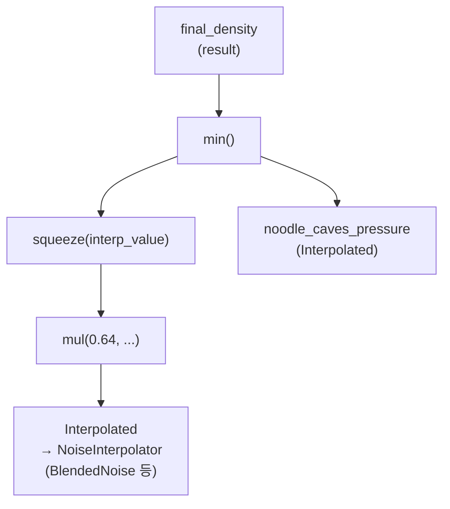
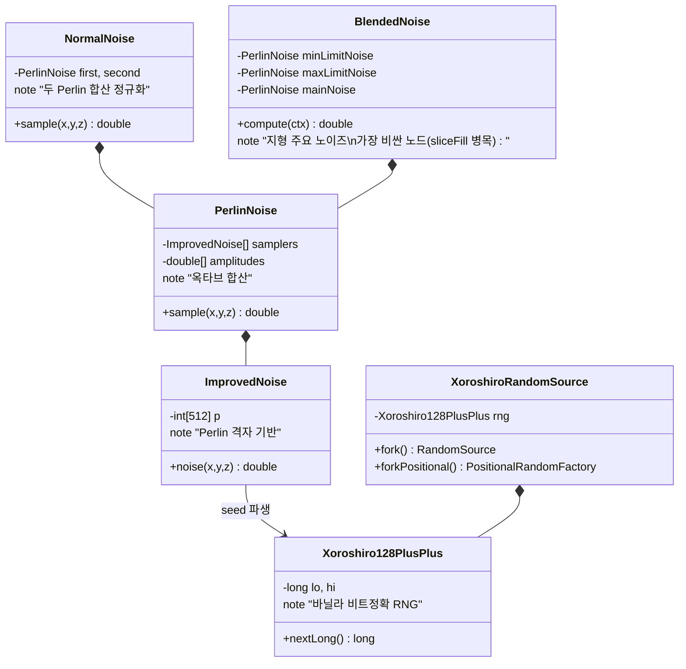

---
tags:
  - Furnace
  - Worldgen
  - NoiseChunk
  - BiomeSampler
  - Performance
aliases:
  - Furnace Worldgen
---

# 월드젠 레이어

[[아키텍처-개요]] > 월드젠

## WorldSource 계층



## 청크 생성 파이프라인



## NoiseChunk 내부 구조



## 셀 좌표 vs 쿼터 좌표

```
cellWidth  = 4 블록  = 1 quart
cellHeight = 8 블록  = 2 quart

Y 축:
  셀 경계:  ..., -64, -56, -48, ..., 312, 320  (8블록 간격)
  biome quart: ..., -64, -60, -56, -52, ...  (4블록 간격)

→ quart Y는 셀 경계보다 촘함 → trilinear Y interpolation 필요
  ty = (absQY & 1) * 0.5  →  0.0 또는 0.5
```

## BiomeSampler — depth-group search



> [!info] 왜 depth-group이 정답인가
> - 기후 6차원 중 `depth` 만 Y에 따라 변함 (나머지 5개 = Y-불변, FlatCache 적용)
> - 컬럼당 5차원 const part를 그룹별로 1번만 계산
> - quart당 비교 = 7593 entry → ~10그룹 (depthMin/Max 조합이 소수)
> - 수학적 동치: `min over entries(c_i + d²) = min over groups(minConst_g + d²)`

## 셀 skip 최적화 (stoneMask)



> [!tip] interval bound 전파
> `DensityFunctions.cellBounds(df, oracle, yMin, yMax)` — DF 트리를 위로 올라가며 구간 연산.
> - `Constant` → [v, v]
> - `ADD` → [a.lo+b.lo, a.hi+b.hi]
> - `MUL` → 4코너 중 min/max
> - `Clamp` → 구간 교차
> - `BlendDensity` → [-∞, +∞] (재귀 필수)
> - `NoiseInterpolator` → oracle이 코너 8개 min/max 반환

## DF 트리 구조



> [!note] 핵심 함정 — mapAll(wrap) 필수
> climate DF를 raw `router.temperature()` 로 직접 compute하면 FlatCache 미작동.
> **반드시 `mapAll(this::wrap)` 통과**시켜야 NoiseChunk 래퍼(FlatCache/Cache2D 등)가 주입됨.

## 노이즈 구현체



## 성능 수치 (M4g-b 핫픽스 후, n=8 warmup 평균)

| 단계 | 이전 | 이후 | 비고 |
|---|---|---|---|
| NoiseChunk 생성 | 3ms | 2ms | 기후 캐시 pre-fill |
| stoneMask | 13ms | **7ms** | 90% 셀 skip |
| └ sliceFill | - | 6ms | BlendedNoise 옥타브 — 잔여 병목 |
| └ block loop | 4ms | 1ms | skip 이후 |
| sampleChunk (biome) | 134ms | **4ms** | depth-group search |
| **TOTAL** | **149ms** | **14ms** | **10.6× 향상** |

> [!warning] view-distance 경고
> `view-distance=64` → 16,641 청크 × 14ms ÷ 4스레드 ≈ **58초**
> 테스트 시 `furnace.properties` → `view-distance=10` 권장 (441청크 ≈ 1.5초)

## WorldgenData / NoiseRouter / NoiseSettings

| 클래스 | 역할 |
|---|---|
| `WorldgenData` | `worldgen/1.21.1/` 리소스 JSON 로드 (noise_settings, density_function 등) |
| `NoiseSettings` | 청크 높이/너비·seaLevel·defaultBlock 등 설정 |
| `NoiseRouter` | 11개 DF 레퍼런스 (temperature/humidity/continents/erosion/depth/ridges/finalDensity 등) |
| `DensityFunctionParser` | JSON → DensityFunction 재귀 파싱 |
| `CubicSpline` | spline DF 노드 (지형 형태 제어) |

## 관련 파일

- `world/gen/WorldSource.java`
- `world/gen/NoiseWorldSource.java`
- `world/gen/AnvilWorldSource.java`
- `world/gen/SuperflatWorldSource.java`
- `world/gen/NoiseChunk.java`
- `world/gen/BiomeSampler.java`
- `world/gen/NoiseRouter.java`
- `world/gen/NoiseSettings.java`
- `world/gen/WorldgenData.java`
- `world/gen/MathHelper.java`
- `world/gen/df/DensityFunction.java`
- `world/gen/df/DensityFunctions.java`
- `world/gen/df/DensityFunctionParser.java`
- `world/gen/df/CubicSpline.java`
- `world/gen/noise/BlendedNoise.java`
- `world/gen/noise/NormalNoise.java`
- `world/gen/noise/PerlinNoise.java`
- `world/gen/noise/ImprovedNoise.java`
- `world/gen/noise/Xoroshiro128PlusPlus.java`
- `world/gen/noise/XoroshiroRandomSource.java`

## 관련 wiki

- [[2026-06-11_worldgen_biome-sampler-perf-hotfix]]
