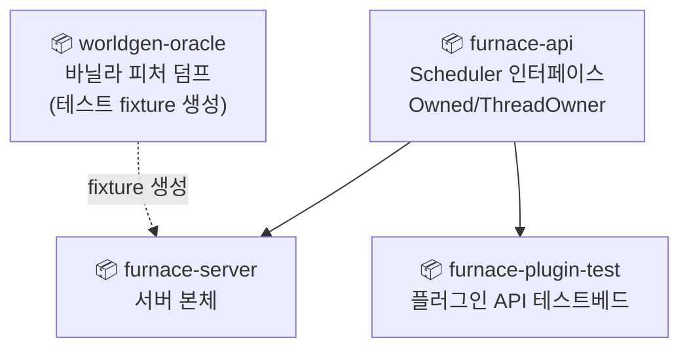
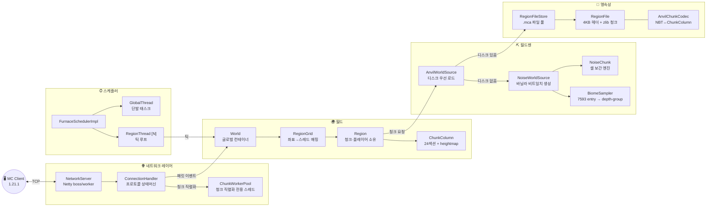
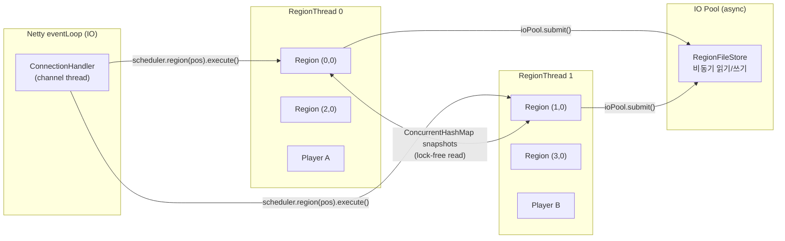
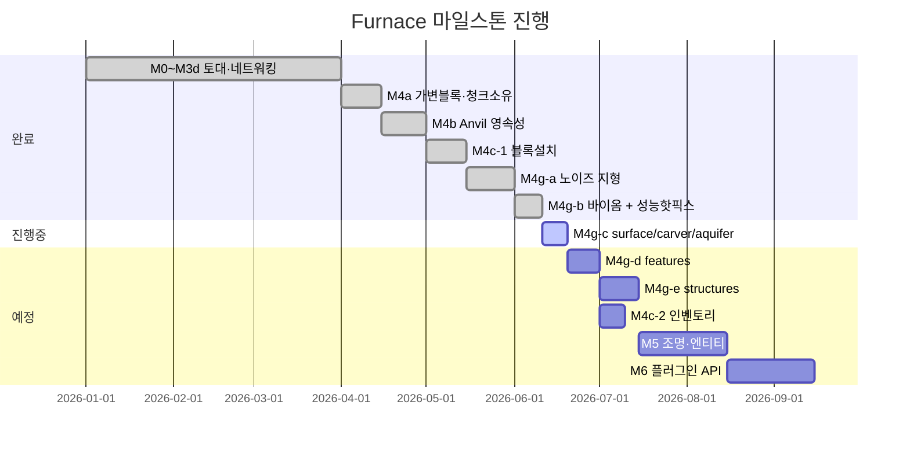

---
tags:
  - Furnace
  - Architecture
  - Overview
aliases:
  - Furnace Overview
  - 퍼니스 아키텍처
---

# Furnace 아키텍처 개요

> [!info] 프로젝트 정체성
> Java 21 바닥부터 구현한 멀티스레드 Minecraft 서버.
> Paper 한계 돌파 / Pumpkin·Leaf급 최적화가 목표.
> 패키지 루트: `org.domi.furnace`

## 모듈 구조

## 전체 런타임 흐름

## 레이어별 상세 페이지

| 레이어 | 페이지 | 핵심 클래스 |
|---|---|---|
| 스케줄러 | [[레이어-스케줄러]] | FurnaceSchedulerImpl, RegionThread, GlobalThread |
| 네트워크 | [[레이어-네트워크]] | NetworkServer, ConnectionHandler, 패킷 클래스들 |
| 월드/청크 | [[레이어-월드]] | World, Region, ChunkColumn, Player |
| 월드젠 | [[레이어-월드젠]] | NoiseChunk, BiomeSampler, DF tree |
| 영속성 | [[레이어-영속성]] | RegionFileStore, AnvilChunkCodec |

## 스레드 소유권 모델

> [!warning] 핵심 불변식
> - `ChunkColumn`, `Player` 는 **소유 RegionThread 에서만** 변경 가능
> - 교차 region 가시성은 `World.snapshots` (ConcurrentHashMap) 경유
> - IO는 전용 ioPool — region 스레드 블로킹 금지

## 마일스톤 상태

